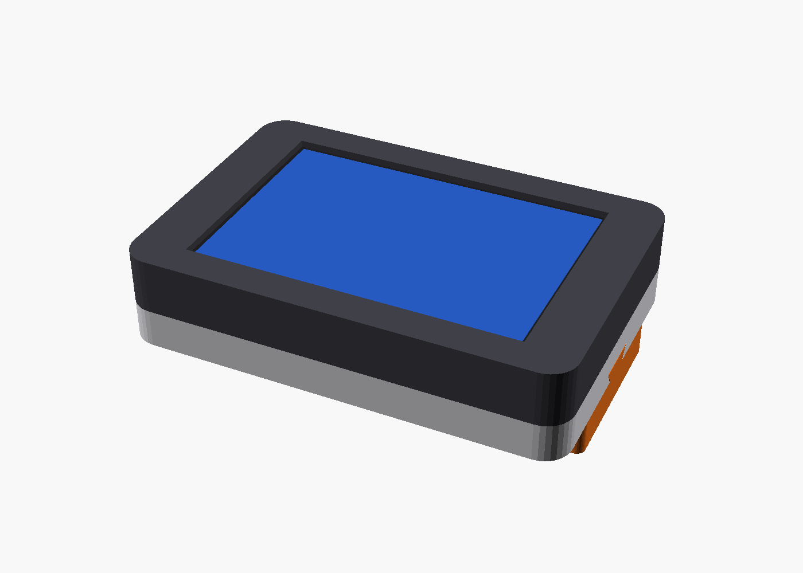
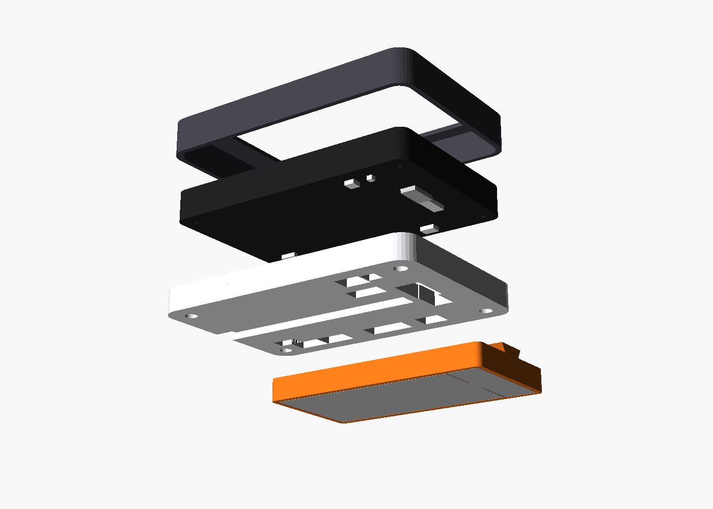

# JC3248W535 — anotações da placa

Placa com ESP32-S3 e tela touch de 3.5". Aqui fica tudo o que já foi descoberto
e feito com ela, para facilitar os próximos projetos.

## Conteúdo desta pasta

| Pasta / arquivo | O que é |
|---|---|
| `placar-mesa/` | **Projeto atual** (gravado na placa): placar de mesa com vários jogos (Riftbound, Magic) |
| `riftbound-contador/` | Protótipo antigo do contador Riftbound (só referência) |
| `backup/jc3248w535_fabrica_16MB.bin` | Cópia completa (16 MB) da memória original de fábrica |
| `site/` | **Gravador pelo navegador** (GitHub Pages): instala firmwares na placa sem IDE |
| `.github/workflows/deploy-pages.yml` | Compila o firmware e publica o gravador no GitHub Pages |
| `case-3d/` | **Case modular para impressão 3D** (OpenSCAD): case base + módulos de bateria e antena. Prévia com medidas da internet |
| `INVENTARIO.md` | **Hardware que eu tenho** (peças, estado de cada uma, ligações planejadas) e descobertas |
| `README.md` | Este arquivo |

**Guarde uma cópia do backup em outro lugar também (pendrive, nuvem).**
SHA-256 do backup: `0316E368593540D189F9F9C4F34947693771373931DA232F7B3DDF4FFDD12163`

## Hardware (lido da placa em 07/11/2026)

- Chip: **ESP32-S3 (QFN56) rev v0.2**, 2 núcleos, 240 MHz, Wi-Fi, Bluetooth 5 (LE)
- PSRAM: **8 MB embutida** (octal, AP 3.3V) → no PlatformIO: `memory_type = qio_opi`
- Flash: **16 MB** (fabricante 0x68, device 0x4018), quad, 3.3V
- Cristal: 40 MHz
- MAC: `28:84:85:49:b7:1c`
- USB: **USB-Serial/JTAG nativo** do S3 (VID `303A`, PID `1001`), aparece como **COM3** no Windows
- Tela: IPS 3.5", **320×480** (retrato nativo), controlador **AXS15231B** via **QSPI**
- Toque: capacitivo, integrado no mesmo AXS15231B, via I2C
- Slot de cartão microSD (SPI)
- Saída de alto-falante **P6** (JST 1,25 mm, 2 pinos): amplificador I2S mono (NS4168 ou
  MAX98357A; o esquema não diz). Saída **diferencial**: nenhum dos fios é GND.
  **Testado em 12/11/2026** com o alto-falante de uma JBL Go 3 (HSS03221, 4 Ω): funciona
  com um firmware de teste de tons (que confirmou os pinos I2S) e no sistema de fábrica,
  que tocou música do cartão SD.
- Conector de bateria **P5** (JST 1,25 mm, 2 pinos), com carregador na placa (talvez IP5306).
  **`+` é o pino mais perto do USB-C.** Testado em 12/11/2026 com a LiPo GSP383562 de 750 mAh
  (da JBL Go 3): carrega pelo USB e a placa roda só na bateria. Ver `INVENTARIO.md`.

## Pinos (confirmados funcionando)

| Função | GPIO |
|---|---|
| Tela QSPI CS | 45 |
| Tela QSPI SCK | 47 |
| Tela QSPI D0 / D1 / D2 / D3 | 21 / 48 / 40 / 39 |
| Luz de fundo (backlight) | 1 (HIGH = liga) |
| Toque I2C SDA / SCL | 4 / 8 |
| Endereço I2C do toque | `0x3B` |
| Toque INT (não usado) | 3 |
| Som I2S BCLK / LRCLK (WS) / DATA | 42 / 2 / 41 (confirmado 12/11/2026) |
| Tela TE (não usado) | 38 |

O toque já sai nas mesmas coordenadas da tela em retrato (0–319, 0–479), sem precisar
inverter nada. Leitura: enviar os bytes
`B5 AB A5 5A 00 00 00 08 00 00 00` e ler 8 bytes; `buf[1]` = número de toques,
`x = ((buf[2]&0x0F)<<8)|buf[3]`, `y = ((buf[4]&0x0F)<<8)|buf[5]`.

## Software que funcionou

- **PlatformIO** com `platform = espressif32@6.9.0` (Arduino core 2.0.x), `board = esp32-s3-devkitc-1`
- Biblioteca **GFX Library for Arduino 1.4.9** (moononournation):
  ```cpp
  Arduino_DataBus *bus = new Arduino_ESP32QSPI(45, 47, 21, 48, 40, 39);
  Arduino_GFX *lcd = new Arduino_AXS15231B(bus, GFX_NOT_DEFINED, 0, false, 320, 480);
  Arduino_Canvas *gfx = new Arduino_Canvas(320, 480, lcd, 0, 0, 0);
  // desenhar em gfx e chamar gfx->flush() para mandar para a tela
  ```
  Desenhar tudo num canvas (memória) e mandar a tela inteira com `flush()` funciona bem.
  `gfx->setRotation(2)` no canvas permite desenhar partes de cabeça pra baixo.
- Bibliotecas comuns como TFT_eSPI **não** funcionam com esta tela.

Configuração completa: ver `placar-mesa/platformio.ini`.

## Pinos do esquema (ainda não confirmados)

Do esquema publicado em [done.land](https://done.land/components/microcontroller/families/esp/esp32/developmentboards/esp32-s3/guitionjc3248w535/).

| Função | GPIO / detalhe |
|---|---|
| Tensão da bateria (ADC1_CH4) | 5, divisor R26 = 33k (em cima) / R27 = 100k → `Vbat = Vpino × 1,33` |
| SD (SPI) CS / MOSI / SCK / MISO | 10 / 11 / 12 / 13 |

A leitura da bateria (`analogReadMilliVolts(5)`, atenuação 11 dB) muda com a bateria
ligada. Os 2457 mV no pino (≈ 3,27 V) que apareceram no primeiro teste são o que a placa
lê **sem bateria** com o USB ligado. A leitura **ainda não foi comparada com o
multímetro**. Se não bater, o fator do divisor precisa ser ajustado. O firmware
`carregador/` mostra a tensão, a carga e o estado na tela.

**Bluetooth de áudio: não disponível (confirmado no chip em 12/11/2026).** O `esptool chip_id`
nesta placa responde `Features: WiFi, BLE`. Como diz a ficha técnica da Espressif, o ESP32-S3 tem só
Bluetooth LE, sem o Bluetooth clássico (BR/EDR) que o perfil de áudio A2DP usa (caixas
como a JBL, fones, celular). Se for isso mesmo, a placa não vira caixa Bluetooth nem manda
som para uma, e o áudio sem fio teria que ir por Wi-Fi.
Evidências até agora (12/11/2026): a leitura do chip em 07/11 mostrou só "Bluetooth 5 (LE)";
um programa de teste com `BluetoothSerial` (Bluetooth clássico) **não compila** para o S3
(faltam as funções `esp_bt_gap_*`, o SDK do S3 não as tem); o sistema de fábrica não usa
Bluetooth nenhum.

## Sistema de fábrica (original)

Feito em Arduino. Não imprime nada na serial depois do boot. Pelos textos dentro do binário:
Arduino sobre **ESP-IDF 5.1.4**, interface em **LVGL**, MP3 com **arduino-libhelix 0.8.3**
(músicas na pasta `/music` do cartão SD). Telas: relógio com temas, álbum (slideshow),
espectro, monitor do PC (AIDA64), clima e player de música, mais uma página web pelo Wi-Fi
para configurar. Não foi achado código-fonte publicado desse aplicativo.

Tabela de partições:

| Nome | Tipo | Início | Tamanho |
|---|---|---|---|
| nvs | data | 0x009000 | 20 KB |
| otadata | data | 0x00E000 | 8 KB |
| app0 | app | 0x010000 | 2048 KB |
| app1 | app | 0x210000 | 2048 KB |
| ffat | data (FAT) | 0x410000 | 12160 KB |
| coredump | data | 0xFF0000 | 64 KB |

## Case modular para impressão 3D (`case-3d/`)

**Estado (12/11/2026): prévia para visualizar, ainda não é para imprimir.** As medidas
vêm da internet ou são suposições. Nada foi medido na placa.




### O que já foi decidido
- **Medidas** ficam só em `case-3d/parametros.scad`, cada uma com uma etiqueta:
  `[NET]` publicada, `[PDF~]` estimada pelos pixels do desenho do fabricante (±1 mm),
  `[SUP]` suposição (**a medir**), `[PROJ]` escolha de projeto.
- **Fonte** da placa: [PDF da Guition](https://done.land/assets/files/jc3248w535%20specifications-en.pdf),
  com módulo de 94,5 × 62,0 mm e área visível de 73,4 × 49,0 mm. Pelo desenho da pág. 5, a placa vem numa
  carcaça com **4 furos nos cantos**, e o **USB-C e todos os conectores ficam nas costas**,
  não nas bordas. Também aparecem um botão de bateria (ao lado do P5) e Boot/Reset. Tudo isso
  **falta confirmar na placa**. A espessura da placa não aparece em nenhuma fonte.
- **Case base** com 2 peças:
  - **moldura**: segura a placa pela borda da tela;
  - **tampa traseira**: parafusa nos furos da placa (M2, suposto) e prende a moldura entre
    a placa e a tampa. Tem janelas para USB-C, P1–P6, botão da bateria e Boot/Reset.
- **Encaixe dos módulos**: trilho em **rabo de andorinha** (fêmea na tampa, macho no módulo),
  entrando pela borda oposta ao USB-C, com **trava de pressão** (calombo + covinha). Um
  módulo por vez. Uma **porta em posição fixa**, igual em todos os módulos, leva a
  ligação elétrica para dentro da case (pensada para um conector magnético pogo de 2 pinos).
- **Módulos prontos na prévia**: cartucho de bateria (JBL 750 mAh ou Rontek 1300 mAh, o mesmo
  arquivo com `bateria = 0/1`) e caixa do NRF24 com o SMA saindo pela ponta. O módulo de
  som (capa da Go 3) fica para depois de medir a capa.
- **Impressão**: todas as peças imprimem **sem suporte** na posição em que saem do arquivo.
  O primeiro teste é `teste_encaixe.scad`: bloco com 3 folgas (0,15 / 0,25 / 0,35 mm) e uma chave.

Espessura total com as suposições atuais: 21,5 mm só a case, 29 mm com a bateria JBL,
34 mm com a Rontek e 37 mm com a antena. A largura é 99 × 67 mm.

### Como usar
```
cd case-3d
./gerar_stl.sh        # todos os STL em case-3d/stl/ (fora do git)
./gerar_previews.sh   # imagens em case-3d/previews/
```
Para ver e girar: abrir `montagem.scad` no OpenSCAD (variáveis `modulo`, `explodir`).
O OpenSCAD 2021.01 está instalado como Flatpak do usuário, com o atalho
`~/.local/bin/openscad`. Ele só enxerga a pasta pessoal (não o `/tmp`). Para exportar PNG ele
precisa de `flatpak run --socket=x11 ...`, que já está no script. Sem isso, o PNG sai vazio.

### Falta (antes de imprimir de verdade)
Medir a placa (lista em `case-3d/MEDIDAS.md`, grupo A): **espessura**, furos (posição,
diâmetro e rosca), posição real dos conectores e do USB-C, onde fica o microSD, e o tamanho
da capa do plugue USB-C do cabo. Depois imprimir o `teste_encaixe` e ajustar `folga_trilho`.

## Comandos úteis

Ferramentas instaladas no Python do usuário (`pip install --user esptool platformio`).

### No Steam Deck (Linux)

O PlatformIO 6.2.0 fica num ambiente Python isolado em `~/.local/share/pio-venv`, com
`pio` ligado em `~/.local/bin`. Instalação:
```
python3 -m venv ~/.local/share/pio-venv
~/.local/share/pio-venv/bin/pip install "platformio==6.2.0"
ln -sf ~/.local/share/pio-venv/bin/pio ~/.local/bin/pio
```
- A placa aparece como `/dev/ttyACM1` (ou outro número), e o usuário `deck` já tem acesso
  pela regra `uaccess` do SteamOS (não precisa de `sudo` nem de regra udev).
- **Cuidado: `/dev/ttyACM0` é o controle embutido do Deck.** Sem porta definida, o
  PlatformIO pode tentar gravar nele. Use o caminho fixo da placa (inclui o MAC):
  `/dev/serial/by-id/usb-Espressif_USB_JTAG_serial_debug_unit_28:84:85:49:B7:1C-if00`
  no `platformio.ini`: `upload_port = <esse caminho>` (curinga `*` nesse caminho não funciona).
- Se a placa não aparecer no `lsusb` (`303a:1001`), troque de porta na dock ou troque o cabo.
  Em 12/11/2026 uma porta do hub não achou a placa, outra porta da dock funcionou.

Compilar e gravar (dentro de `placar-mesa/`):
```
python -m platformio run -t upload
```

Rodar os testes da lógica no PC (precisa do gcc/MinGW no PATH):
```
python -m platformio test -e native
```

Ver o que a placa imprime na serial:
```
python -m platformio device monitor
```

Ler informações do chip:
```
python -m esptool --port COM3 --chip esp32s3 flash-id
```

**Voltar a placa para o sistema de fábrica** (dentro desta pasta):
```
python -m esptool --port COM3 --chip esp32s3 --baud 921600 write-flash 0 backup/jc3248w535_fabrica_16MB.bin
```

## Problemas já encontrados e soluções

- **esptool não conecta ("No serial data received")**: desconecte e reconecte o cabo USB-C
  e tente de novo. Foi o que resolveu. Não foram achados botões BOOT/RST visíveis na placa.
- **Erro de compilação "No such file or directory" em arquivos que existem**: limite de
  260 caracteres de caminho do Windows. O `platformio.ini` já manda a compilação para
  `C:/Users/filho/.rb/` (caminho curto) por causa disso.
- **pip dá "Permission denied"**: o Python está em `C:\Python311` (pasta protegida); use `pip install --user`.
- **Teste nativo "errored with 3221225785"** (0xC0000139): o .exe pegou uma `libstdc++-6.dll`
  incompatível do PATH (Git, Neovim...). Resolvido linkando estático (`scripts/linkar_estatico.py`).
- **Log do boot não aparece na serial**: com USB nativo, o que é impresso antes do PC abrir a
  porta se perde. O `setup()` espera até 1,5 s pela porta antes de imprimir.
- **Fontes lisas**: a GFX só ativa fontes u8g2 se a biblioteca `olikraus/U8g2` estiver no
  `lib_deps` (ela traz as fontes `logisoso`). Fontes `_tn` só têm números e `+ - , . / :`.

## Projeto: placar de mesa (`placar-mesa/`)

A placa fica deitada no meio da mesa; cada metade da tela é virada para um jogador
(baixo = AZUL, cima = VERMELHO, desenhado de cabeça pra baixo).

- **Menu inicial**: um botão por jogo (gerado do registro), repetido para os dois lados.
  O último jogo escolhido fica com contorno dourado (salvo na NVS).
- **Riftbound**: pontos até 8 (metade esquerda do painel = −1, direita = +1), série melhor
  de três (bolinhas), tela de resultado com *Desfazer* / *Próxima partida* / *Nova série*.
- **Magic**: vida 20/30/40 (salva na NVS), ±1 (segurar repete), ±5, variação recente
  ("−7", some em 3 s), veneno (10 = derrota).
- **Comum**: cronômetro na faixa do meio (toque inicia/pausa; depois de zerar conta o
  acréscimo); botão **≡** em cada painel abre as opções (zerar, voltar ao menu...),
  sempre com confirmação e virado para quem tocou.
- Regras ajustáveis em `lib/nucleo/config_jogos.h` (pontos, vida, tempo da rodada = 50 min).
- `DEBUG_TOQUE 1` em `src/hal/config_placa.h` mostra uma bolinha onde a placa sentiu o toque.

### Estrutura

| Pasta | Responsabilidade |
|---|---|
| `lib/nucleo/` | Lógica pura, sem Arduino (testada no PC): gestos, cronômetro, regras dos jogos, orientação espelhada, pilha de telas, interfaces `Relogio`/`Armazenamento` |
| `src/hal/` | Hardware: tela (canvas + flush), toque I2C, backlight, `millis()`, NVS. Único lugar com pinos |
| `src/ui/` | Desenho: `Pintor` (fontes e primitivas), tema (cores/tipografia), componentes, geometria do layout duelo |
| `src/telas/` | Menu inicial e diálogos genéricos (opções, confirmação) |
| `src/jogos/` | `DueloBase` (2 jogadores + cronômetro + opções), um subdiretório por jogo e `registro_jogos.cpp` |
| `test/` | Testes Unity (`[env:native]`) |

Fluxo do `loop()`: toque cru → `ReconhecedorGestos` (Tap / LongPress / Repeat / Release)
→ `GerenciadorTelas` (só a tela do topo recebe) → `atualizar` → redesenha só se algo
ficou sujo → `flush()` da tela inteira.

Coordenadas: cada jogador desenha e testa toques em coordenadas **locais** (a metade dele
é sempre a de baixo); `paraLocal()` e `Pintor::orientar()` cuidam da rotação.

### Como adicionar um jogo novo

1. Se tiver regras, crie `lib/nucleo/meujogo_regras.h/.cpp` (estado puro, tempo recebido
   como parâmetro) e um teste em `test/test_meujogo/`.
2. Crie `src/jogos/meujogo/tela_meujogo.h/.cpp`:
   - para 2 jogadores frente a frente, herde de `DueloBase` e implemente
     `desenharPainel`, `aoEventoPainel` e `montarOpcoes` (cronômetro, botão ≡,
     "Zerar tempo" e "Voltar ao menu" já vêm prontos);
   - para outro formato, herde direto de `Tela`.
   - O construtor recebe `Contexto&`.
3. Registre em `src/jogos/registro_jogos.cpp` (único lugar):
   ```cpp
   {"Meu jogo", "subtítulo", cor::MINHA_COR, "meu", criar<TelaMeuJogo>},
   ```
   e inclua o header. O menu se ajusta sozinho.
4. `python -m platformio test -e native` e `python -m platformio run -t upload`.

## Protótipo antigo: contador Riftbound (`riftbound-contador/`)

- Metade de baixo = EU (azul), metade de cima = OPONENTE (vermelho, de cabeça pra baixo).
- Lado esquerdo do painel = −1, lado direito = +1 (do ponto de vista de cada jogador).
- Faixa do meio = tempo (duas cópias, uma para cada lado). Toque rápido inicia/pausa;
  segurar 2 s começa nova partida.
- Vitória com **8 pontos** (painel dourado, "VENCEU!"). Tempo da rodada: **50 min**
  (palpite; mude `TEMPO_RODADA_S` em `src/main.cpp`). Depois de zerar, conta o acréscimo.
- `DEBUG_TOQUE 1` em `src/main.cpp` mostra uma bolinha onde a placa sentiu o toque.

## Gravador pelo navegador (`site/` + GitHub Pages)

Site estático que grava firmwares na placa **pelo navegador** (Chrome/Edge/Opera no
computador), sem IDE, driver ou linha de comando. Mesma ideia do `bruce.computer/flasher`:
usa a **Web Serial API** + a biblioteca **esp-web-tools** (Apache-2.0), que está
**embutida no repositório** (`site/vendor/esp-web-tools/`, versão 10.4.0) — nada de CDN.

Dois firmwares são oferecidos:
- **Placar de Mesa (TCG)** — o nosso sistema, com preview da interface, explicação e
  prints (menu, Riftbound e Magic).
- **Firmware de fábrica** — a cópia de 16 MB do `backup/`, para voltar ao original.

### Camadas de segurança (de propósito, nada é pulado)
- Só grava em **contexto seguro**: HTTPS (GitHub Pages) ou `localhost`.
- O navegador **pede permissão** da porta serial; nada roda sem o usuário autorizar.
- A biblioteca de gravação é aberta e local; o firmware de fábrica permite reverter.
- O site tem **Content-Security-Policy**: só carrega scripts do próprio domínio (o JS
  fica em `site/assets/app.js`, nada inline).
- Cada card mostra o **SHA-256** dos `.bin` publicados (`SHA256SUMS.txt`, gerado pela CI
  e pelo `servir_local.py`) para conferir o que vai ser gravado.
- Na CI: actions fixadas por **SHA**, PlatformIO com **versão fixa**, e a permissão de
  publicar no Pages só existe no job `deploy` (o `build`, que baixa toolchain e
  bibliotecas, só lê o repositório).
- A cópia de fábrica é publicada no Pages (decisão consciente): é software do fabricante
  e contém o MAC da placa; não contém senha de Wi-Fi.

### Como publicar no GitHub Pages
1. Suba este repositório para o GitHub (branch `main`).
2. Em **Settings → Pages**, em *Build and deployment*, escolha **Source: GitHub Actions**.
3. O workflow `deploy-pages.yml` roda sozinho: compila o placar-mesa com PlatformIO,
   junta os binários + a cópia de fábrica e publica. O endereço final aparece em
   **Settings → Pages** (algo como `https://<usuario>.github.io/<repo>/`).
   - Dá para rodar na mão em **Actions → "Build firmware..." → Run workflow**.

> Observação: o firmware do placar-mesa é **compilado na CI** (os runners do GitHub têm
> internet para baixar o toolchain do ESP32). O `platformio.ini` aponta o build para um
> caminho do Windows; no Linux da CI isso é contornado com `PLATFORMIO_BUILD_DIR` e a
> busca dos `.bin` por `find`, sem alterar a ini.

### Testar no seu PC antes de publicar
`localhost` também é contexto seguro, então dá para gravar de verdade sem publicar:

```
python site/servir_local.py
```

Abra `http://localhost:8000`, conecte a placa e teste (o card de fábrica já funciona).
Para testar também o placar-mesa, compile-o e aponte a pasta de build:

```
python -m platformio run                                  # dentro de placar-mesa/
python site/servir_local.py --placar-build "C:/Users/filho/.rb/pm-build/jc3248w535"
```

### Como são servidos os binários (ESP Web Tools)
Cada firmware tem uma pasta em `site/firmwares/` com um `manifest.json`:
- **fábrica**: uma única parte no offset `0x0` (imagem de 16 MB).
- **placar-mesa**: `bootloader.bin` (0x0), `partitions.bin` (0x8000),
  `boot_app0.bin` (0xe000) e `firmware.bin` (0x10000).
Os `.bin` **não ficam no git** — a CI (ou o `servir_local.py`) os coloca na publicação.

### Adicionar um firmware novo ao gravador (ex.: sensor de temperatura/clima)
1. Crie `site/firmwares/<seu-projeto>/manifest.json` (copie um existente; `chipFamily`
   continua `ESP32-S3`).
2. Faça a CI gerar os `.bin` desse projeto e copiá-los para essa pasta (adapte o
   `deploy-pages.yml`), **ou** coloque binários prontos lá.
3. Adicione um card no `site/index.html` com `<esp-web-install-button manifest="...">`.

> Projeto futuro já planejado: medir **temperatura/clima dentro e fora de casa** para
> saber a hora de abrir as janelas — entra aqui como mais um card/firmware.
